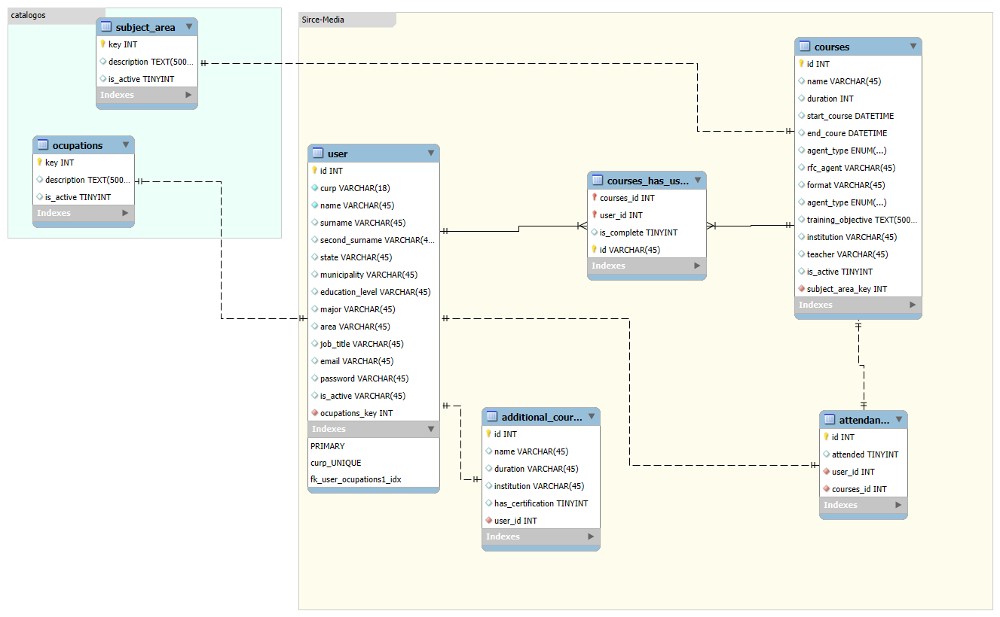

# Manual de Desarrollador

El precente sistema tiene como objetivo satisfcer la gestión de cursos, tomar asistencia hacia el personal de HR Media, gestionar correos, 

- El presente proyecto esta desarrollado bajo el lenguaje de PHP v.8.4, utilizando el framework [Laravel v.13](https://laravel.com/docs/13.x)
- Se utilizo tambien el template [Mazer](https://github.com/zuramai/mazer), con la finalidad de ajilizar el desarrollo; 
- Para modulazizar el desarrollo se opto por la utilizacion de la libreria [livewire v3](https://livewire.laravel.com/docs/3.x/quickstart)
- La autenticación se realizo con el paquete de [Brezze](https://www.google.com/search?client=firefox-b-d&q=laravel+brezze%2C+laravel+13)
- Integracion con compoentes livewire Volt

### El Maqutado de la base de datos

